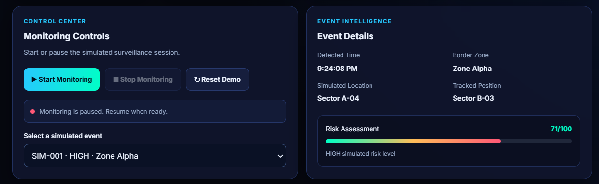
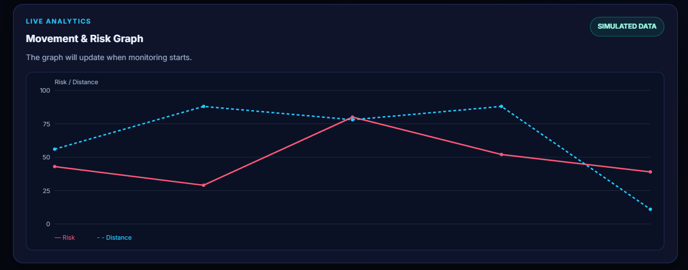
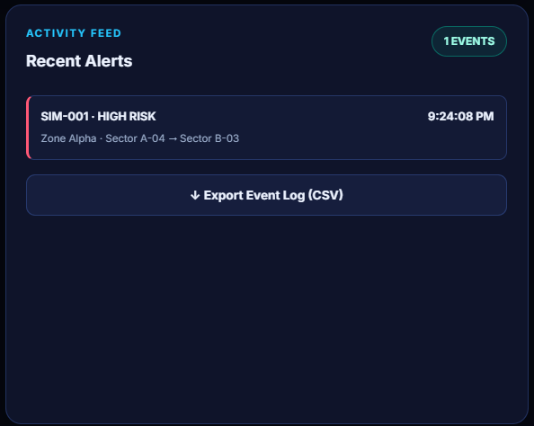

# 🚁 Drone Border Surveillance System (DBSS)

An interactive web-based dashboard prototype that demonstrates simulated drone surveillance, event monitoring, risk analysis, and alert management through a responsive user interface.

## 🌐 Live Demo

[**View Live Project**](https://rakshitamahesh.github.io/Drone-Project/)

## 📌 Project Overview

The Drone Border Surveillance System is designed to demonstrate how surveillance-related information can be displayed and organized through an interactive dashboard. It provides monitoring controls, simulated events, visual risk indicators, map-based markers, and an alert history.

This project focuses on frontend development, interactive user interfaces, and data visualization.

## ✨ Key Features

- **Interactive Dashboard** — View surveillance-related information in one place.
- **Monitoring Controls** — Interact with the dashboard controls.
- **Simulated Event Detection** — Generate and display sample surveillance events.
- **Risk Analysis** — Visualize simulated risk information.
- **Surveillance Map** — Display illustrative map markers.
- **Recent Alerts** — View the history of simulated events.
- **Data Export** — Export simulated event logs as CSV.
- **Responsive Design** — Use the dashboard across different screen sizes.

## 🖥️ Screenshots

### 1. Main Dashboard


### 2. Monitoring Controls


### 3. Surveillance Map


### 4. Risk Analysis


### 5. Recent Alerts


## 🛠️ Technologies Used

- HTML5
- CSS3
- JavaScript
- Canvas API
- GitHub Pages

## ⚙️ How to Run Locally

1. Clone the repository:

   ```bash
   git clone https://github.com/RakshitaMahesh/Drone-Project.git
   ```

2. Open the project folder.
3. Open `index.html` in your browser.

No additional installation is required for the basic frontend prototype.

## 🎯 Project Objectives

- Develop an interactive surveillance dashboard interface.
- Demonstrate simulated event monitoring and risk visualization.
- Organize alerts and event logs in a user-friendly format.
- Apply frontend development skills to a practical prototype.

## 🔮 Future Enhancements

- Integrate authorized live sensor or drone data.
- Add secure user authentication and role-based access.
- Develop backend storage for event history.
- Improve map visualization and analytics.
- Explore AI-based event classification using suitable datasets.

## ⚠️ Limitations and Disclaimer

This project is an educational frontend prototype that uses simulated data. It is not connected to real drones, cameras, GPS devices, or physical sensors. The displayed events and risk indicators are illustrative and should not be used for real-world surveillance or security decisions.

## 👩‍💻 Author

**Rakshita Mahesh**

[GitHub Repository](https://github.com/RakshitaMahesh/Drone-Project) | [Live Demo](https://rakshitamahesh.github.io/Drone-Project/)

---


