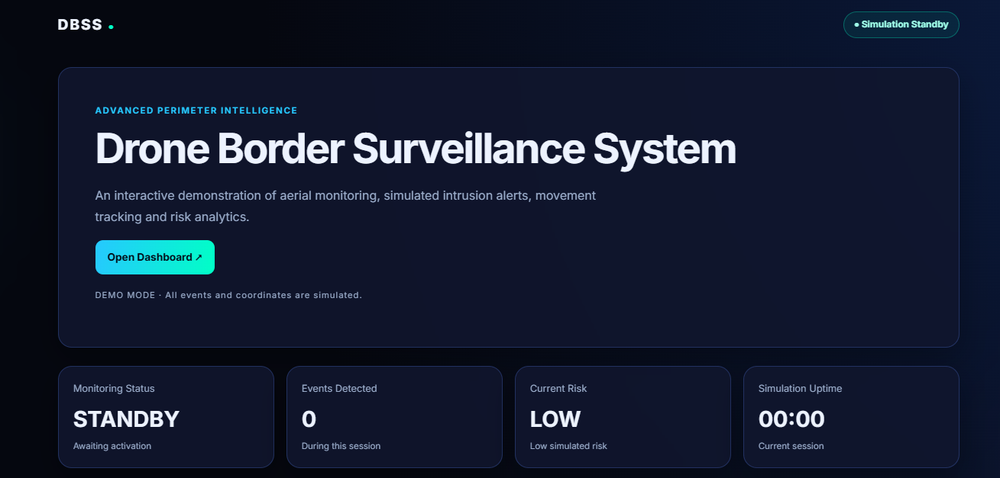

# Drone-
# Drone Border Surveillance System (DBSS)
## Dashboard Preview

An interactive web-based prototype demonstrating a drone border surveillance dashboard with simulated monitoring, event alerts, risk assessment, and movement analytics.

## Live Demo

https://rakshitamahesh.github.io/Drone-Project/

## Features

- Interactive monitoring dashboard
- Start, stop, and reset controls
- Simulated event generation and selection
- Dynamic movement and risk graph
- Risk score and event details
- Schematic surveillance map with moving markers
- Recent alert history
- CSV export of simulated event logs
- Responsive dark-themed user interface

## Technologies Used

- HTML5
- CSS3
- JavaScript
- HTML Canvas API
- GitHub Pages

## How to Run Locally

1. Clone or download this repository.
2. Open the project folder.
3. Open `index.html` in a browser, or use the Live Server extension in Visual Studio Code.
4. Click **Start Monitoring** to run the demonstration.

## Project Purpose

This project demonstrates the design of a browser-based surveillance dashboard and the visualization of simulated monitoring events. It is intended for educational and demonstration purposes.

## Important Disclaimer

This prototype uses generated demonstration data. It is not connected to a real drone, GPS device, camera, sensor, or operational surveillance system.

## Author

Rakshita Mahesh
